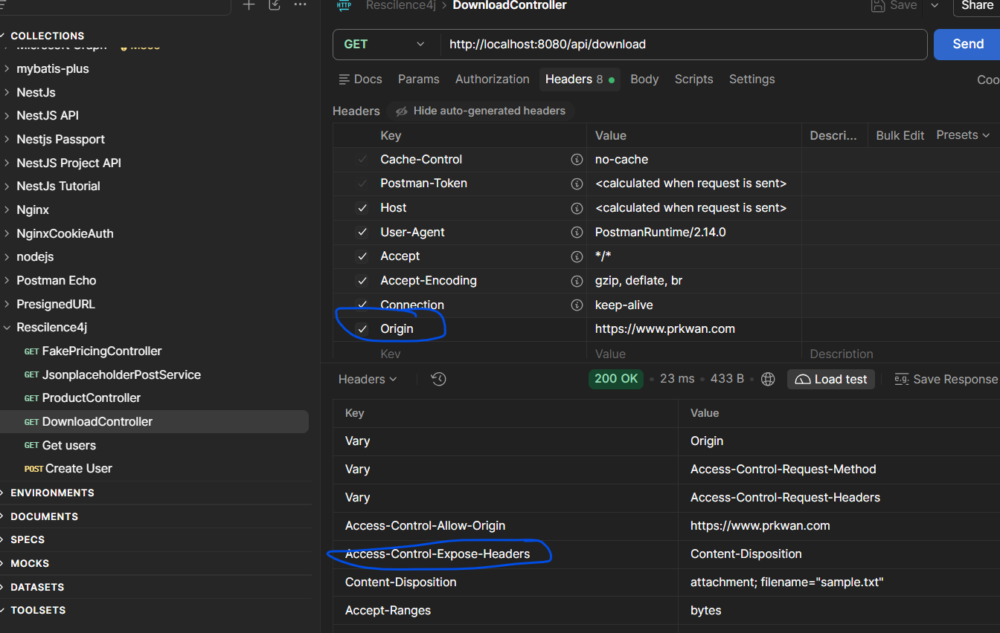

docker run \
 --rm \
 -e SONAR_HOST_URL="http://192.168.104.144:9000/" \
 -e SONAR_TOKEN="sqp_08eadc01bc43099cc1e3c185f75779279e0edab1" \
-v ".:/usr/src" \
 sonarsource/sonar-scanner-cli

# Access-Control-Expose-Headers  
Reponse with Content-Disposition such that front end can read the filename from Content-Disposition  
Content-Disposition: attachment; filename="sample.txt"  

